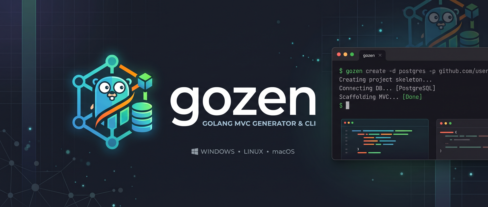

# gozen
Gozen is a fast, cross-platform CLI tool designed to eliminate repetitive boilerplate and jumpstart backend development in Go. With a single command, Gozen scaffolds production-grade Go applications built on a clean Model-View-Controller (MVC) architectural pattern—complete with pre-configured database connectivity, dependency wiring, and standard project layouts.

Read project documentation for more information here: [Documentation](docs/README.md).



## Key Features
- Instant MVC Scaffolding: Generates organized, maintainable folder structures separating data models, controllers, and application configuration.
- Turnkey Database Setup: Automatically wires database drivers, pool configurations, and environment loaders with zero manual stitching.
- Module-Ready Initialization: Sets up your Go module paths ([github.com/user/app](https://github.com/user/app)) directly during creation, ensuring clean imports out of the box.
- Cross-Platform Support: Ships as a lightweight, zero-dependency standalone binary compiled natively for Linux, macOS, and Windows.

## Installation
Download and install executable binary from GitHub releases page.

### Linux Installation
```sh
# Use latest tag name from release page
TAG=<tag-name>

curl -sL "https://github.com/tech-thinker/gozen/releases/download/${TAG}/gozen-linux-amd64" -o gozen
chmod +x gozen
sudo mv gozen /usr/bin
```

### MacOS Installation
```sh
# Use latest tag name from release page
TAG=<tag-name>

curl -sL "https://github.com/tech-thinker/gozen/releases/download/${TAG}/gozen-darwin-amd64" -o gozen
chmod +x gozen
sudo mv gozen /usr/bin
```

- Or using homebrew
```sh
brew tap tech-thinker/tap
brew install gozen
```

### Windows Installation
```sh
# Use latest tag name from release page
TAG=<tag-name>

curl -sL "https://github.com/tech-thinker/gozen/releases/download/${TAG}/gozen-windows-amd64.exe" -o gozen.exe
gozen.exe
```

### Verify checksum
```sh
# Use latest tag name from release page
TAG=<tag-name>

# Using sha256sum
curl -sL "https://github.com/tech-thinker/gozen/releases/download/${TAG}/checksum-sha256sum.txt" -o checksum-sha256sum.txt
sha256sum --ignore-missing --check checksum-sha256sum.txt

# Using md5sum
curl -sL "https://github.com/tech-thinker/gozen/releases/download/${TAG}/checksum-md5sum.txt" -o checksum-md5sum.txt
md5sum --ignore-missing --check checksum-md5sum.txt
```
Output:
```sh
gozen-darwin-amd64: OK
gozen-darwin-amd64.tar.gz: OK
gozen-darwin-arm64: OK
gozen-darwin-arm64.tar.gz: OK
gozen-linux-amd64: OK
gozen-linux-amd64.tar.gz: OK
gozen-linux-arm: OK
gozen-linux-arm.tar.gz: OK
gozen-linux-arm64: OK
gozen-linux-arm64.tar.gz: OK
gozen-windows-amd64.exe: OK
gozen-windows-i386.exe: OK
```

## CLI Guide
- `gozen` help
```sh
gozen -h
```

- Create new project
```sh
gozen create -d <database-driver> -p github.com/<username>/<appname> <appname>
```
Note: `database-driver` is one of `postgres`, `mysql`, `sqlite`.

- Chenge directory to new project directory
```sh
cd <appname>
```

- Install dependencies
```sh
go mod tidy
```

- Change `.env` file as per your requirements and export `.env`.
```sh
export $(cat .env | xargs)
```

- Run project
```sh
go run main.go start
```
